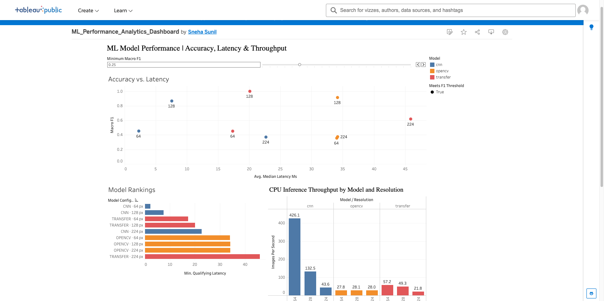

# ML Performance Analytics Dashboard

An interactive Tableau dashboard for comparing classification quality and CPU inference performance across three image-classification models and three input resolutions. The experiment records **45 runs** (nine model-resolution configurations, repeated five times each) in SQLite and uses SQL-aggregated results for analysis.

[**View the interactive Tableau dashboard**](https://public.tableau.com/app/profile/sneha.sunil4233/viz/ML_Performance_Analytics_Dashboard/MLPerformanceAnalyticsDashboard)



## What it shows

- **Accuracy–latency trade-off:** scatterplot of macro F1 against median CPU prediction latency.
- **Interactive threshold:** minimum macro F1 parameter highlights qualifying configurations.
- **Dynamic ranking:** configurations that meet the threshold are sorted by latency.
- **Throughput:** comparison in images per second across nine configurations.

At an F1 threshold of **0.85**, the fastest qualifying configuration in this benchmark was **CNN at 128 px** (macro F1 **0.8667**, median prediction latency approximately **7.57 ms**).

## Experiment design

| Models | Resolutions | Repeated trials | Recorded trials |
|---|---|---|---|
| OpenCV/Random Forest, CNN, ResNet18 transfer learning | 64, 128, 224 px | 5 each | 45 |

All configurations were tested on the **same 24 held-out synthetic images** derived from six original photographs. These are small pilot measurements, **not full-test model-performance estimates**. Each model was trained separately beforehand. The timed measurements concern model prediction only, excluding decoding, preprocessing, and HTTP overhead. Different input sizes were evaluated using models trained at 128 px.

## Data and validation

- `data/matched_benchmark.sqlite`: SQLite tables for configurations and measurements.
- `reports/matched_runs.csv`: individual measurements from all 45 runs.
- `reports/tableau_matched_summary.csv`: configuration-level SQL-aggregated export used by Tableau.
- `reports/matched_audit.json`: audit of missing measurements, incomplete repetitions, duplicate run keys, and invalid values.
- `reports/METHODOLOGY.md`: protocol details and limitations.
- `finalize_matched.py`: regenerates the reports and aggregated CSV from SQLite.
- `run_matched_benchmark.py`: benchmark implementation (requires separate trained model artifacts and original source images).

The audit recorded **9 configurations, 45 runs, zero validation issues**.

## Reproducing the analysis

Create a Python environment and install the analysis dependencies:

```bash
python3 -m venv .venv
source .venv/bin/activate
pip install -r requirements.txt
python finalize_matched.py
```

The included SQLite database allows regeneration of the report without model retraining. Re-running inference also needs PyTorch, torchvision, Pillow, OpenCV, scikit-learn, joblib, the original source image archive, and the previously trained model checkpoints. Set the dataset path in `run_matched_benchmark.py` for your machine. Large pretrained weights and original photos are intentionally excluded from this public repository.

## Tableau

The live workbook is published on [Tableau Public](https://public.tableau.com/app/profile/sneha.sunil4233/viz/ML_Performance_Analytics_Dashboard/MLPerformanceAnalyticsDashboard). The data it visualizes is included in `reports/tableau_matched_summary.csv`. The editable Tableau `.twbx` file is **not part of this archive**; export it from Tableau Public/Desktop and add it separately if you want the repository to contain a portable workbook.

## Tools

Python · SQL · SQLite · pandas · NumPy · scikit-learn · PyTorch · Tableau Public
